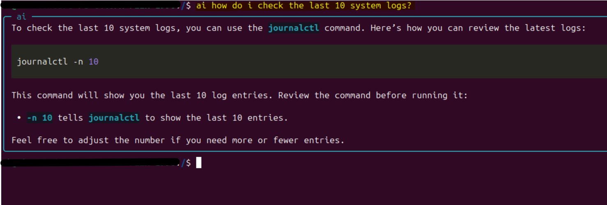
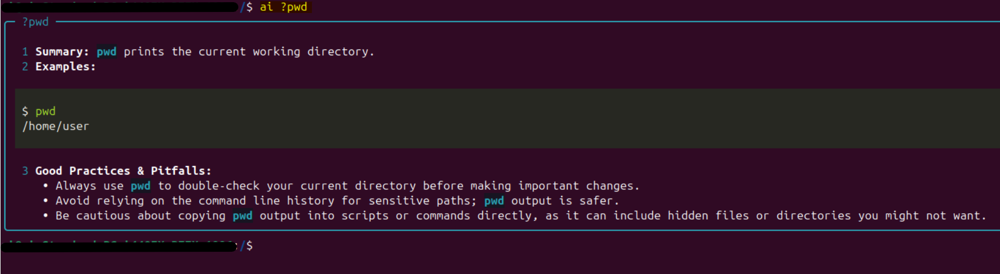
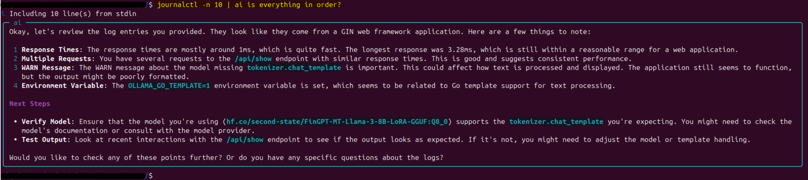
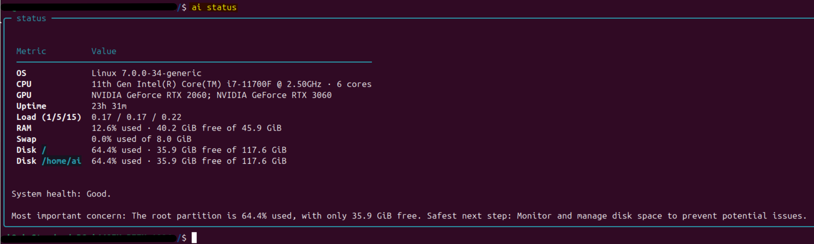
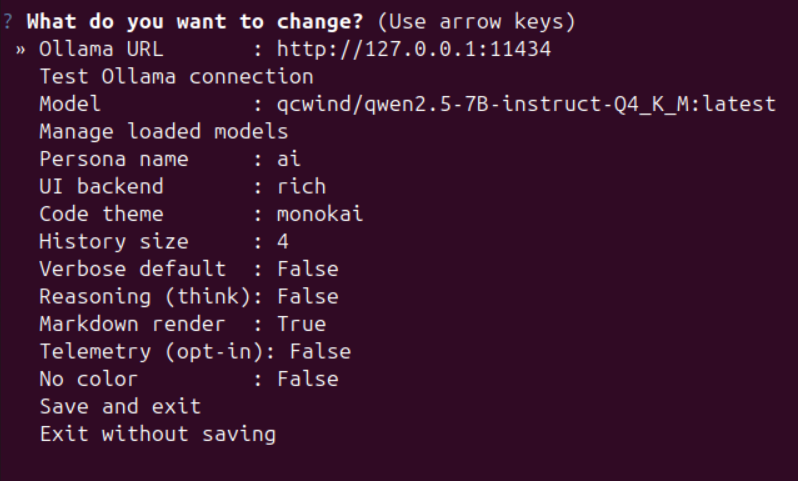

# ai-sys-buddy

[English](README.md) | **Polski**

Lekki, prywatny asystent terminalowy z przyjazną osobowością
Stworzony z myślą o starszym sprzęcie i małych, szybkich modelach AI, łączy się z
lokalną lub zdalną instancją [Ollamy](https://ollama.com), pomaga w diagnostyce,
uczy komend i pokazuje metryki wydajności modeli.

> **Zbudowany na skromny sprzęt.** Stare maszyny i małe, szybkie modele AI to
> jego żywioł; przy zintegrowanej grafice (lub bez GPU) obliczenia wykonuje CPU.

> **Domyślnie tylko odczyt.** `ai-sys-buddy` nigdy nie wykonuje komend za Ciebie.
> Model produkuje wyłącznie tekst i formatuje komendy w ramkach; Ty je
> przeglądasz i uruchamiasz ręcznie. Nic nie jest wysyłane poza Twój serwer
> Ollama.



## Użycie

### Zadaj pytanie

```bash
ai jak sprawdzic uzycie dysku na Linuksie?
ai dlaczego moja usluga sie nie uruchamia?
```


### Sprawdź komendę

```bash
ai ?chmod
ai ?systemctl
```



### Analiza wyjścia z potoku (Linux)

```bash
sudo journalctl -u pveproxy -n 50 | ai co tu sie dzieje?
cat error.log | ai dlaczego to nie dziala?
```



### Status systemu

```bash
ai status
```



### Ustawienia, benchmark i pomoc

```bash
ai s            # menu ustawień (alias: ai settings)
ai perf         # benchmark bieżącego modelu
ai perf all     # benchmark wszystkich zainstalowanych modeli
ai help         # pomoc
```



### Tryb interaktywny

Wpisz `ai` i naciśnij Enter, aby wejść w tryb czatu:

```bash
ai
```

Potem wpisuj pytania. W trybie interaktywnym możesz użyć `?komenda` do haseł
encyklopedii, `status` do briefingu, `perf` do benchmarku, `s` do ustawień i
`exit`, aby wyjść.

## Funkcje

- **Świadomość systemu** — wykrywa Linux i Windows i dopasowuje podpowiedzi.
- **Tryb diagnostyczny** — `ai dlaczego dysk jest pełny?`
- **Tryb encyklopedii** — `ai ?chmod` to krótki, praktyczny przewodnik.
- **Potoki i sudo** — `sudo journalctl -n 50 | ai co tu sie dzieje?`
- **Interaktywny czat** — wpisz po prostu `ai` i naciśnij Enter; mały REPL z
  krótkoterminową pamięcią rozmowy.
- **Status systemu** — `ai status` daje przyjazny briefing na podstawie
  bieżącego snapshotu (CPU, RAM, dysk, uptime, load, GPU).
- **Metryki** — flaga `-v` pokazuje czas ładowania, tokeny i tokeny/sekundę.
- **Telemetria i benchmark** — `ai perf` porównuje modele; opcjonalny lokalny
  panel sprzęt + wydajność pokazuje się, gdy go włączysz.
- **Menu ustawień** — wybór modelu, URL, osobowości, motywu i backendu strzałkami.
- **Działa na skromnym sprzęcie** — stworzony dla starszych maszyn i małych,
  szybkich modeli AI. Przy zintegrowanej grafice (lub bez GPU) obliczenia
  wykonuje po prostu CPU.
- **Awaryjny tryb bez zależności** — backend `standard` działa bez `rich`.

## Wymagania

- Działający serwer Ollama (`ollama serve`), domyślnie `http://127.0.0.1:11434`.
- Co najmniej jeden pobrany model, np. `ollama pull llama3.2`. Przy pierwszym
  uruchomieniu narzędzie poprosi o wybór z listy zainstalowanych modeli.

## Instalacja

### Linux

Pobierz najnowszą binarkę `ai-sys-buddy` ze strony
[Releases](https://github.com/brodatech-lab/ai-sys-buddy/releases), nadaj prawa
wykonania i umieść w `PATH`:

```bash
chmod +x ai-sys-buddy
mv ai-sys-buddy ~/.local/bin/ai
```

Albo zainstaluj ze źródeł (Python 3.10+):

```bash
git clone https://github.com/brodatech-lab/ai-sys-buddy.git
cd ai-sys-buddy
./install.sh
```

`install.sh` tworzy środowisko wirtualne, instaluje pakiet w trybie edytowalnym
i podlinkowuje komendę `ai` do `~/.local/bin`. Jeśli ten katalog nie jest w
`PATH`, skrypt wypisze jedną linię do dodania.

Wolisz ręcznie?

```bash
python -m venv .venv && source .venv/bin/activate
pip install .
```

### Windows

Instalacja jedną komendą PowerShell:

```powershell
irm https://raw.githubusercontent.com/brodatech-lab/ai-sys-buddy/main/install.ps1 | iex
```

Albo pobierz `install.ps1` i uruchom (opcjonalnie połóż obok `ai-sys-buddy.exe`,
aby zainstalować offline):

```powershell
powershell -ExecutionPolicy Bypass -File .\install.ps1
```

Instalator kopiuje `ai-sys-buddy.exe` do
`%LOCALAPPDATA%\Programs\ai-sys-buddy`, tworzy komendę `ai`, dodaje ją do
Twojego `PATH` i pyta o adres Ollamy oraz model. Po instalacji otwórz nowy
terminal i używaj `ai` dokładnie tak jak na Linuksie.

Deinstalacja:

```powershell
powershell -ExecutionPolicy Bypass -File .\install.ps1 -Uninstall
```

## Opcje

Te opcje dotyczą komendy `ai` oraz skompilowanej binarki `ai-sys-buddy` (Linux)
/ `ai-sys-buddy.exe` (Windows).

| Opcja | Opis |
| --- | --- |
| `-v`, `--verbose` | Pokaż metryki wydajności modelu. |
| `--think` | Włącz rozumowanie modelu (tylko modele myślące). |
| `--no-markdown` | Wypisz czysty tekst zamiast renderowanego Markdown. |
| `--theme NAME` | Motyw kolorowania kodu (backend rich). |
| `--model NAME` | Nadpisz model dla tego uruchomienia. |
| `--url URL` | Nadpisz adres Ollamy dla tego uruchomienia. |
| `--backend rich\|standard` | Wybór backendu UI. |
| `--no-color` | Wyłącz kolory. |
| `--config PATH` | Użyj alternatywnego pliku konfiguracji. |
| `--version` | Pokaż wersję i zakończ. |

## Konfiguracja

Przechowywana per użytkownik:

- Linux: `~/.config/ai-sys-buddy/config.json`
- Windows: `%APPDATA%\ai-sys-buddy\config.json`

| Klucz | Domyślnie | Znaczenie |
| --- | --- | --- |
| `ollama_url` | `http://127.0.0.1:11434` | Bazowy adres Ollamy. |
| `model` | _(pusty)_ | Wybrany model; wybierany przy pierwszym starcie. |
| `persona_name` | `ai` | Nazwa kumpla w promptach (może być `buddy`). |
| `ui_backend` | `rich` | `rich` albo `standard`. |
| `history_size` | `4` | Liczba wymian w pamięci rozmowy (FIFO). |
| `verbose_default` | `false` | Zawsze pokazuj metryki. |
| `think` | `false` | Włącz rozumowanie modelu (tylko modele myślące). |
| `markdown` | `true` | Renderuj odpowiedzi jako Markdown w ramce. |
| `code_theme` | `monokai` | Motyw kolorowania składni dla bloków kodu. |
| `telemetry_enabled` | `false` | Pokazuj lokalny panel telemetrii (sprzęt + wydajność) po każdej odpowiedzi. |
| `no_color` | `false` | Wyłącz kolory. |

## Prywatność i bezpieczeństwo

- Brak telemetrii, brak analityki, brak połączeń poza Twój adres Ollamy.
- Narzędzie nie potrafi i nie będzie wykonywać komend. Wszystko jest doradcze.
- Proponowane komendy służą do ręcznego przejrzenia; nigdy nie przekierowuj ich
  bezpośrednio do shella.

## Development

```bash
python -m venv .venv && source .venv/bin/activate
pip install . pyinstaller
python -m unittest discover -s tests
```

Budowanie samodzielnej binarki:

```bash
pyinstaller --onefile --name ai-sys-buddy --clean main.py
```

## Licencja

Zobacz plik `LICENSE` dołączony do repozytorium.
